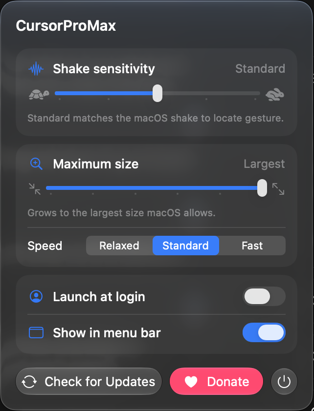

# CursorProMax

Shake to find your cursor, and keep shaking to make it bigger and bigger

## Download

  

## Features

- The real macOS pointer keeps growing for as long as you shake it, like on KDE, instead of stopping at one size
- Grows up to the largest size macOS allows and shrinks back when you stop
- Every pointer stays sharp when enlarged, including hands, resize arrows and other cursors macOS only ships in low resolution
- Adjustable shake sensitivity, with Standard matching the macOS shake to locate gesture
- A maximum size limit, from 2× up to the largest size macOS allows, and a choice of growth speed
- Launch at login
- Hide the menu bar icon if you like, and open the app again whenever you want its settings
- Automatic updates through Sparkle
- Lives in the menu bar, with no Dock icon and no Accessibility permission needed

Requires macOS 26 or later.

## License

CursorProMax is free software under the [GNU General Public License v3.0](LICENSE).

## Contributors

